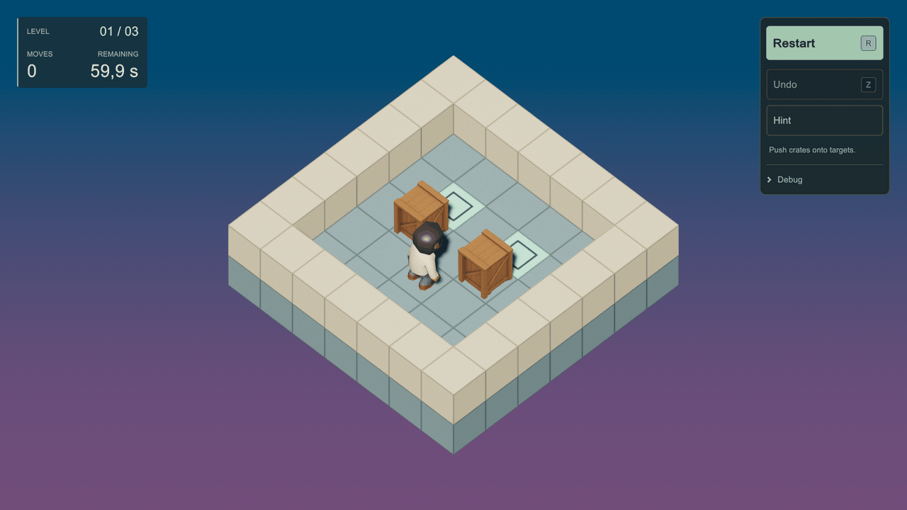

# Sokoban — Unity / DefaultEcs

A small, playable 3D Sokoban learning project. It explores deterministic ECS rules, object-oriented application infrastructure, and safe asynchronous presentation loading. It keeps simulation rules independent of Unity while giving them a playable presentation.

## Engineering highlights

- **Synchronous Core.** A pure C# DefaultEcs simulation runs movement, pushing, undo, goal checks and the timer in an explicit system order. Time arrives as a supplied tick delta; Core has no Unity dependency.
- **Explicit application ownership.** Application objects own run creation, input orchestration, presentation and teardown. UI actions queue requests through a command inbox; views read published status rather than changing the simulation directly.
- **Safe asynchronous loading.** Addressables handles have explicit owners. Presentation applies completed loads on the main thread only after checking the relevant run, entity and request identities; hints also check board revision. Cancellation stops individual waiters without releasing shared cached prefab handles, and late outcomes remain observed.
- **Replay through the same rules.** Watching a completed attempt creates a fresh ECS simulation and reproduces recorded commands and exact tick deltas through the production rule pipeline. The original attempt is preserved for Back. Recordings stay in memory; this is simulation playback, not video capture or a saved replay browser.

## Playable scope

Three levels, one character choice retained across a playthrough, restart/timeout recovery, undo, asynchronous hints, completion results, and completed-attempt replay with Pause/Resume and Back. Hints recommend a move without executing it or pausing the countdown.

**Stack:** Unity 6000.0.63f1, C#, DefaultEcs, Zenject/Extenject, UniTask, Addressables, HDRP, runtime UI Toolkit, Input System and PrimeTween. Project EditMode/PlayMode tests cover rules, replay, UI behavior and asynchronous resource lifecycles.

## Run locally

1. Open **`Sokoban/`** in Unity **6000.0.63f1** and let dependencies resolve and scripts compile.
2. Open `Assets/_Sokoban/Scenes/GameplayScene.unity`.
3. Run **Tools > Sokoban > Validate Addressable Addresses**. In **Window > Asset Management > Addressables > Groups**, build **Build > New Build > Default Build Script** before using **Use Existing Build** in Play Mode. For asset-based authoring, **Use Asset Database (fastest)** needs no content build.
4. Enter Play Mode, choose a character and press **Start**. Move with **Arrows/WASD**, restart with **R**, undo with **Z**, and request hints through the UI.

See [Setup](docs/SETUP.md) for content/build details, [Architecture](docs/ARCHITECTURE.md) for boundaries and ownership, or the [documentation index](docs/README.md).

## Credits

DefaultEcs — Paillat Laszlo; Zenject — Modest Tree Media; UniTask — Cysharp; PrimeTween — Kyrylo Kuzyk. Visuals include reused character, crate and sky assets. See [credits and provenance](docs/CREDITS.md) for verified sources, license notes and unresolved visual attribution.
